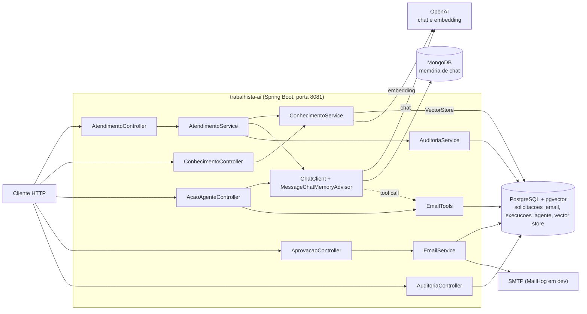

# 02 — Arquitetura (AS-IS)

## 1. Estilo

Monólito Spring Boot em camadas simples, num único módulo Maven e num único processo (porta 8081, `application.yaml:1-2`). Pacote raiz: `br.com.cotiinformatica.trabalhista_ai`.

| Camada | Pacote | Conteúdo |
|---|---|---|
| Entrada HTTP | `controllers` | 5 controllers REST |
| Aplicação/negócio | `services` | `AtendimentoService`, `ConhecimentoService`, `EmailService`, `AuditoriaService` |
| Ferramentas do modelo | `tools` | `EmailTools` |
| Persistência | `entities`, `repositories` | 2 entidades JPA e 2 `JpaRepository` |
| Contratos | `dtos` | 3 records |
| Configuração | `config` | `AiConfig` |

Não há camada de domínio separada, nem portas (interfaces) para o provedor de modelo, o banco vetorial ou o SMTP. Os serviços usam diretamente `ChatClient`, `VectorStore`, `JavaMailSender` e os repositories.

## 2. Arquitetura geral

## 3. Decisões arquiteturais visíveis no código

| Decisão | Evidência |
|---|---|
| Um único bean `ChatClient` com advisor de memória, compartilhado por atendimento e ação do agente | `AiConfig.java:26-36` |
| Memória por janela de 10 mensagens sobre `MongoChatMemoryRepository` | `AiConfig.java:16-23` |
| Saída estruturada por `BeanOutputConverter<AtendimentoResultado>`, com o formato injetado no prompt | `AtendimentoService.java:44-45,69-70,111-113` |
| RAG montado em código: busca, concatenação do contexto e prompt (sem `QuestionAnswerAdvisor`) | `AtendimentoService.java:36-42` |
| HITL por separação: a tool só cria registro `PENDENTE`, o envio fica em `EmailService.aprovar` | `EmailTools.java:19-46`, `EmailService.java:35-60` |
| Auditoria e custo calculados em código a partir de `usage` da resposta | `AuditoriaService.java:28-81` |
| Esquema relacional gerado pelo Hibernate (`ddl-auto: update`), sem migrações | `application.yaml:16-19` |
| Esquema vetorial criado pelo Spring AI (`initialize-schema: true`) | `application.yaml:49-54` |

## 4. Desvios em relação à Clean Architecture e às regras globais do Marcus

Registro apenas do que existe, sem implicar correção:

- **Dependência de framework no núcleo.** Não há domínio isolado. As entidades JPA têm campos `public` e são devolvidas pela API (`AprovacaoController.java:26,31,39`, `AuditoriaController.java:25`).
- **Controller com lógica de orquestração.** `AcaoAgenteController` chama `ChatClient`, define o prompt de sistema e registra a tool dentro do controller (`AcaoAgenteController.java:42-59`). Não há service nem auditoria nesse fluxo.
- **Controller acessa repository.** `AuditoriaController` usa `ExecucaoAgenteRepository` direto (`AuditoriaController.java:18-29`).
- **Sem portas para fronteiras externas.** Modelo, banco vetorial e e-mail são usados diretamente nos serviços.
- **Prompt em string no código.** O prompt de atendimento está num text block em `AtendimentoService.java:47-71` e o de ação em `AcaoAgenteController.java:43-51`. Não há arquivo de prompt versionado.
- **Sem transação declarada.** Nenhum `@Transactional` no código.
- **Sem handler global de exceções.** Nenhum `@ControllerAdvice`/`@RestControllerAdvice`.
- **Injeção por `@Value` em campo.** `AuditoriaService.java:18-22` e `EmailService.java:20-21` (o construtor é usado para as demais dependências).

## 5. Observações

- Não há comunicação entre serviços ou agentes. O que pode parecer "dois agentes" (atendimento e ação) são dois usos do **mesmo** `ChatClient` no mesmo processo. Ver `07-integracoes-ia.md`.
- Nenhuma fila, cache, agendador ou processamento assíncrono. Tudo é síncrono dentro da requisição HTTP.
