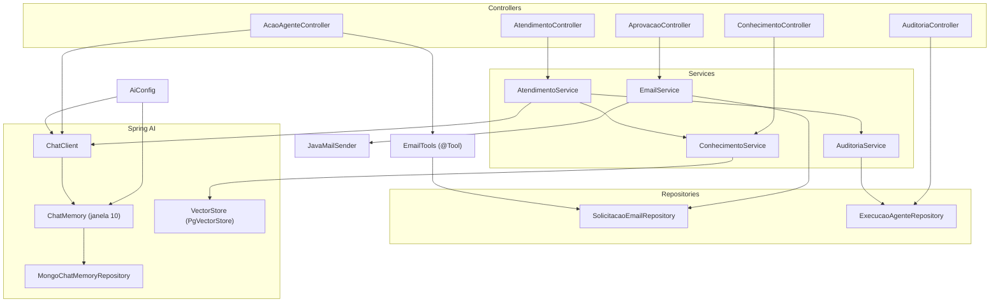

# 03 — Componentes (AS-IS)

Pacote base: `br.com.cotiinformatica.trabalhista_ai`.

## 1. Inventário

| Componente | Tipo | Responsabilidade observada | Depende de |
|---|---|---|---|
| `TrabalhistaAiApplication` | `@SpringBootApplication` | Ponto de entrada | — |
| `config.AiConfig` | `@Configuration` | Cria `ChatMemory` (janela de 10 mensagens, repositório MongoDB) e o `ChatClient` com `MessageChatMemoryAdvisor` | `MongoChatMemoryRepository`, `ChatModel` |
| `controllers.AtendimentoController` | `@RestController` `/api/atendimentos` | Recebe a pergunta validada e delega | `AtendimentoService` |
| `controllers.ConhecimentoController` | `@RestController` `/api/conhecimentos` | Cadastra texto e pesquisa trechos | `ConhecimentoService` |
| `controllers.AcaoAgenteController` | `@RestController` `/api/agente/acoes` | Executa o comando com tool de e-mail. Contém prompt de sistema e chamada ao modelo | `ChatClient`, `EmailTools` |
| `controllers.AprovacaoController` | `@RestController` `/api/aprovacoes` | Lista pendentes, aprova e rejeita | `EmailService` |
| `controllers.AuditoriaController` | `@RestController` `/api/auditoria` | Lista execuções por usuário | `ExecucaoAgenteRepository` |
| `services.AtendimentoService` | `@Service` | Busca contexto, monta o prompt, chama o modelo, converte a saída, audita sucesso e erro | `ChatClient`, `ConhecimentoService`, `AuditoriaService` |
| `services.ConhecimentoService` | `@Service` | Divide o texto em pedaços de 1000 caracteres e grava no `VectorStore`. Faz `similaritySearch` | `VectorStore` |
| `services.EmailService` | `@Service` | Lista pendentes. Aprova (envia SMTP e marca `ENVIADO`) ou rejeita | `JavaMailSender`, `SolicitacaoEmailRepository` |
| `services.AuditoriaService` | `@Service` | Persiste `ExecucaoAgente` com modelo, tokens, custo estimado, duração, status e erro | `ExecucaoAgenteRepository`, `app.pricing.*` |
| `tools.EmailTools` | `@Component` | Tool `solicitarEnvioEmail`: grava `SolicitacaoEmail` `PENDENTE` | `SolicitacaoEmailRepository` |
| `entities.SolicitacaoEmail` | `@Entity` `solicitacoes_email` | Solicitação de e-mail pendente de decisão | — |
| `entities.ExecucaoAgente` | `@Entity` `execucoes_agente` | Registro de auditoria de uma chamada ao modelo | — |
| `repositories.SolicitacaoEmailRepository` | `JpaRepository<SolicitacaoEmail, Long>` | `findByStatus` | — |
| `repositories.ExecucaoAgenteRepository` | `JpaRepository<ExecucaoAgente, UUID>` | `findByUsuarioId` | — |
| `dtos.PerguntaRequest` | record | `usuarioId`, `conversaId`, `pergunta`, todos `@NotBlank` | — |
| `dtos.ConhecimentoRequest` | record | `texto`, `fonte`, ambos `@NotBlank` | — |
| `dtos.AtendimentoResultado` | record | Saída estruturada do modelo: `assunto`, `resposta`, `fundamentacao`, `fontes`, `informacaoEncontrada`, `encaminharEspecialista` | — |

## 2. Diagrama de componentes e dependências

## 3. Observações

- `AtendimentoService` é o único ponto que usa `ConhecimentoService.pesquisar` com intenção de RAG. O `ConhecimentoController` também o expõe diretamente.
- `AuditoriaService` só é chamado por `AtendimentoService`. O fluxo de `AcaoAgenteController` não gera registro em `execucoes_agente`.
- `EmailTools` não conhece usuário nem conversa. A identidade de quem pediu o e-mail não chega à tool nem à entidade.
- Entidades usam campos `public` e valores iniciais em campo (`status = "PENDENTE"`, `criadoEm = LocalDateTime.now()`, `id = UUID.randomUUID()`).
