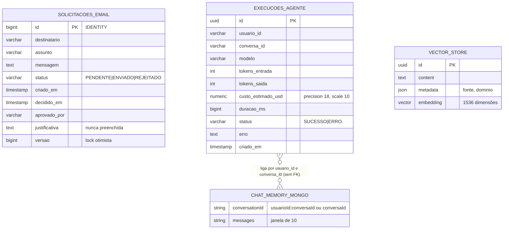

# 05 — Modelo de dados (AS-IS)

Há três armazenamentos: tabelas JPA no PostgreSQL, o índice vetorial (também no PostgreSQL, via pgvector) e a memória de chat no MongoDB.

## 1. Diagrama entidade-relacionamento

Não existe nenhuma chave estrangeira. As ligações são lógicas e feitas por texto:

- `execucoes_agente.usuario_id` + `conversa_id` correspondem à chave de memória `usuarioId:conversaId` do fluxo de atendimento.
- `solicitacoes_email` não referencia usuário, conversa nem execução.

Os nomes de colunas acima são os que o Hibernate gera por padrão a partir dos nomes dos campos (`criadoEm` → `criado_em`). **NÃO VERIFICADO** em banco.

## 2. Tabelas JPA

### `solicitacoes_email` (`entities/SolicitacaoEmail.java`)

| Campo | Tipo Java | Observações |
|---|---|---|
| `id` | `Long` | `@Id`, `GenerationType.IDENTITY` |
| `destinatario` | `String` | sem validação de formato |
| `assunto` | `String` | tamanho padrão do Hibernate (varchar 255) |
| `mensagem` | `String` | `columnDefinition = "TEXT"` |
| `status` | `String` | padrão `"PENDENTE"`. Valores usados no código: `PENDENTE`, `ENVIADO`, `REJEITADO`. Não há enum nem constraint |
| `criadoEm` | `LocalDateTime` | inicializado em campo com `now()` |
| `decididoEm` | `LocalDateTime` | preenchido em aprovar e rejeitar |
| `aprovadoPor` | `String` | texto livre vindo do query param `responsavel` |
| `justificativa` | `String` (TEXT) | **não é escrita em nenhum ponto do código** |
| `versao` | `Long` | `@Version` (lock otimista) |

### `execucoes_agente` (`entities/ExecucaoAgente.java`)

| Campo | Tipo Java | Observações |
|---|---|---|
| `id` | `UUID` | `@Id`, gerado em campo por `UUID.randomUUID()` |
| `usuarioId`, `conversaId` | `String` | sem índice declarado, embora `findByUsuarioId` filtre por `usuarioId` |
| `modelo` | `String` | `response.getMetadata().getModel()` |
| `tokensEntrada`, `tokensSaida` | `Integer` | de `usage.getPromptTokens()/getCompletionTokens()` |
| `custoEstimadoUsd` | `BigDecimal` | `precision 18, scale 10` |
| `duracaoMs` | `Long` | medido em torno da chamada ao modelo |
| `status` | `String` | `SUCESSO` ou `ERRO` |
| `erro` | `String` (TEXT) | mensagem da exceção |
| `criadoEm` | `LocalDateTime` | inicializado em campo |

Quando `usage` ou `metadata` é nulo, `modelo`, tokens e custo ficam `null` (`AuditoriaService.java:41-78`).

## 3. Índice vetorial

Configuração (`application.yaml:49-54`): `initialize-schema: true`, `dimensions: 1536`, `index-type: HNSW`, `distance-type: COSINE_DISTANCE`. A dimensão 1536 corresponde ao modelo de embedding configurado, `text-embedding-3-small` (`application.yaml:45-47`).

Cada chunk é um `org.springframework.ai.document.Document` com:
- texto: até 1000 caracteres consecutivos, sem sobreposição (`ConhecimentoService.java:25-32`);
- metadados: `fonte` (informada pelo cliente) e `dominio = "trabalhista"` (constante) (`ConhecimentoService.java:34-40`).

**Não há** metadados de dono, data, versão do modelo de embedding, identificador do documento de origem nem posição do chunk.

O nome da tabela e as colunas reais criadas pelo `PgVectorStore` (o padrão da biblioteca é uma tabela `vector_store`) não estão no repositório: **NÃO VERIFICADO**.

## 4. Memória conversacional (MongoDB)

- `MessageWindowChatMemory` com `maxMessages(10)` sobre `MongoChatMemoryRepository` (`AiConfig.java:16-23`).
- URI: `mongodb://localhost:27018/bd_trabalhista_memoria`, sem usuário nem senha (`application.yaml:24-26`).
- Chave de conversa (`ChatMemory.CONVERSATION_ID`):
  - atendimento: `usuarioId + ":" + conversaId` (`AtendimentoService.java:89-92`);
  - ação do agente: somente `conversaId` (`AcaoAgenteController.java:54-57`).
- Conteúdo gravado: as mensagens trocadas com o modelo. Em atendimento, a mensagem de usuário é o prompt inteiro (regras, contexto recuperado e pergunta), porque o prompt é passado em `.user(prompt)` (`AtendimentoService.java:87-88`). Isso é inferência do código; o conteúdo real do Mongo é **NÃO VERIFICADO**.
- Nome da coleção e esquema do documento definidos pela biblioteca: **NÃO VERIFICADO**.
- Não há TTL, rotina de limpeza nem endpoint para apagar memória.

## 5. Esquema e migrações

- Relacional: `spring.jpa.hibernate.ddl-auto: update` (`application.yaml:18`). O Hibernate cria e altera tabelas ao subir. Não há Flyway/Liquibase nem scripts SQL.
- `show-sql: true` e `format_sql: true` (`application.yaml:19-22`) imprimem SQL no log.
- Vetorial: criado pelo Spring AI na inicialização.

## 6. Retenção e exclusão

Nenhum dado tem prazo de retenção definido no código. Não há remoção de chunks, de memória, de solicitações de e-mail nem de execuções. `ConhecimentoService` só tem `cadastrar` e `pesquisar`.
