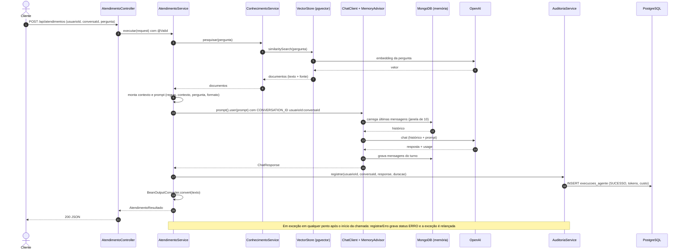
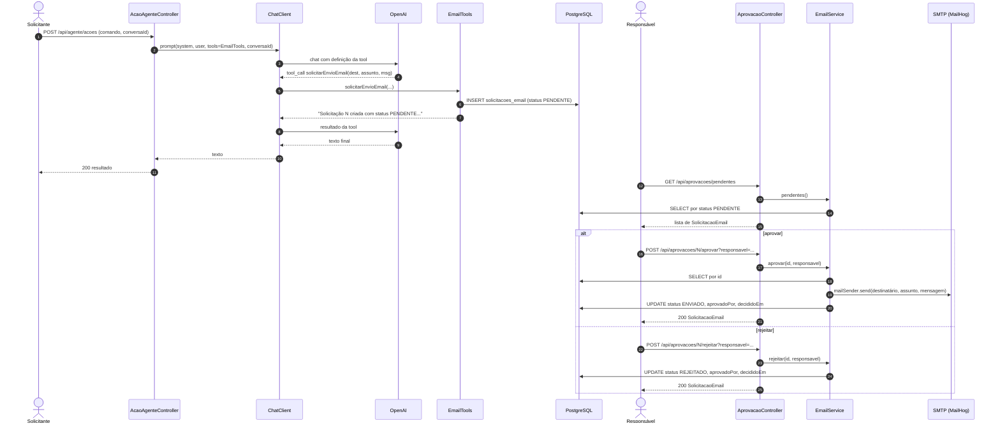

# 06 — Fluxos de negócio (AS-IS)

## F1. Atendimento com RAG e memória

Entrada: `POST /api/atendimentos` → `AtendimentoController.executar` → `AtendimentoService.executar`.

Passos (`AtendimentoService.java`):

1. Busca por similaridade no `VectorStore` com a própria pergunta (`:36-37`).
2. Monta o contexto: cada trecho vira `"Fonte: <metadado fonte>\n<texto>"`, separados por linha em branco (`:39-42`).
3. Cria o `BeanOutputConverter<AtendimentoResultado>` e obtém `converter.getFormat()` (`:44-45`).
4. Renderiza o prompt (regras + `{contexto}` + `{pergunta}` + `{formato}`). Sem trecho recuperado, o contexto vira "Nenhum documento recuperado." (`:47-81`).
5. Chama o modelo com `.user(prompt)` e `CONVERSATION_ID = usuarioId:conversaId`. O advisor de memória carrega e grava o histórico (`:87-94`).
6. Se a resposta ou o resultado for nulo, lança `IllegalStateException` (`:99-102`).
7. Grava auditoria de sucesso com tokens e custo (`:104-109`).
8. Converte o texto da resposta para `AtendimentoResultado` e devolve (`:111-113`).
9. Em qualquer exceção, grava auditoria de erro e relança (`:115-124`).

Dados envolvidos: pergunta, trechos recuperados, histórico (até 10 mensagens), resposta. Para a OpenAI saem a pergunta (para embedding) e o prompt completo com histórico (para o chat).

Pontos de atenção (inconsistências, ver `12-dividas-tecnicas.md`):
- Se o passo 8 falhar depois do passo 7, o mesmo atendimento terá um registro `SUCESSO` e outro `ERRO`.
- O passo 1 ocorre fora do `try`: falha na busca vetorial ou no embedding não gera registro de auditoria.
- `AtendimentoService` não registra tools, então este fluxo não envia nem solicita e-mail.

## F2. Cadastro de conhecimento (ingestão)

Entrada: `POST /api/conhecimentos` → `ConhecimentoService.cadastrar(texto, fonte)`.

1. Percorre o texto em blocos de 1000 caracteres, sem sobreposição e sem respeitar palavras, artigos ou parágrafos (`ConhecimentoService.java:25-32`).
2. Para cada bloco, cria um `Document` com metadados `fonte` e `dominio` (`:34-40`).
3. Chama `vectorStore.add` **uma vez por bloco** (`:42`), o que gera o embedding de cada bloco.
4. Responde `Conhecimento armazenado.`

Não há: autenticação, limite de tamanho, validação de tipo ou conteúdo, antivírus, deduplicação, dono do documento, nem identificador para remover depois. Se uma chamada falhar no meio do texto, os blocos anteriores permanecem gravados (publicação parcial).

## F3. Busca de conhecimento

`GET /api/conhecimentos/pesquisar?pergunta=` → `vectorStore.similaritySearch(pergunta)` → devolve só `getText()` de cada trecho. Sem fonte, sem pontuação.

## F4. Ação do agente com ferramenta de e-mail (Function Calling)

Entrada: `POST /api/agente/acoes` → `AcaoAgenteController.executar`.

1. Exige `comando` e `conversaId` não vazios (`:36-40`).
2. Chama o modelo com prompt de sistema de RH, `.user(comando)`, `.tools(emailTools)` e `CONVERSATION_ID = conversaId` (`:42-59`).
3. O modelo pode decidir chamar `solicitarEnvioEmail(destinatario, assunto, mensagem)` (`EmailTools.java:25-46`), que grava `SolicitacaoEmail` com status `PENDENTE` e devolve texto "Solicitação N criada com status PENDENTE. O e-mail ainda não foi enviado."
4. O texto final do modelo volta em `{ "resultado": ... }`.

Este fluxo não passa por `AuditoriaService`: não há registro de tokens, custo, duração ou erro.

## F5. Aprovação humana e envio (Human in the Loop)

Regras implementadas em `EmailService`:
- Só decide se o status for `PENDENTE`, senão `IllegalStateException` (`:41-44`, `:68-71`).
- `aprovar` e `rejeitar` são `synchronized`, o que só serializa chamadas dentro de uma instância da aplicação.
- Na aprovação, o envio SMTP acontece **antes** de gravar `ENVIADO`. Se o `save` falhar depois do envio, o registro continua `PENDENTE` e pode ser aprovado de novo (reenvio).
- O remetente vem de `app.mail.from` (`application.yaml:66-67`).

## F6. Consulta de auditoria

`GET /api/auditoria/usuario/{usuarioId}` → `ExecucaoAgenteRepository.findByUsuarioId`. Devolve as execuções gravadas só pelo fluxo F1.

## F7. Cálculo de custo

`AuditoriaService.registrar`: `(tokensEntrada × input-per-million + tokensSaida × output-per-million) / 1.000.000`, escala 10, `HALF_UP` (`:62-76`). Preços vêm de `app.pricing.*` (`application.yaml:62-65`: 0.40 e 1.60). Os valores não foram conferidos com a tabela do provedor.

## Fluxos que não existem

Remoção de documento do conhecimento, expiração da memória, reenvio de e-mail, notificação ao responsável de que há pendências, delegação a outro agente e chamada a servidor MCP.
