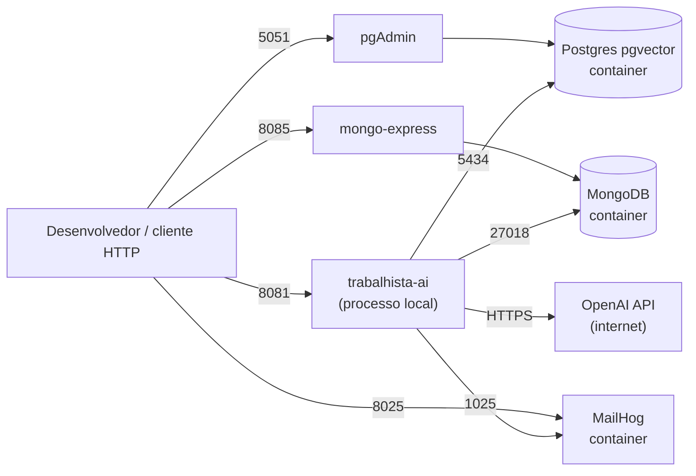

# 08 — Infraestrutura (AS-IS)

Fontes: `docker-compose.yml`, `src/main/resources/application.yaml`, `pom.xml`, `.gitignore`. Os valores de usuário e senha de desenvolvimento existem no YAML e no Compose; **não são reproduzidos aqui**.

## 1. Serviços do Docker Compose

| Serviço | Imagem | Porta host → container | Volume | Uso |
|---|---|---|---|---|
| `postgres` | `pgvector/pgvector:pg17` | 5434 → 5432 | `postgres_data` | Tabelas JPA e índice vetorial. Tem healthcheck (`pg_isready`) |
| `pgadmin` | `dpage/pgadmin4:9` | 5051 → 80 | — | Administração do Postgres. Depende do Postgres saudável |
| `mongodb` | `mongo:7` | 27018 → 27017 | `mongo_data` | Memória conversacional. **Sem autenticação** |
| `mongo-express` | `mongo-express:1` | 8085 → 8081 | — | Administração do Mongo. Com autenticação básica |
| `mailhog` | `mailhog/mailhog:v1.0.1` | 1025 (SMTP), 8025 (UI) | — | SMTP de desenvolvimento que captura e-mails |

A aplicação **não** está no Compose: roda fora (porta 8081). Não há `Dockerfile`, pipeline de CI (`.github/` contém só scripts de um recurso de upgrade Java) nem manifestos de implantação.

## 2. Configuração da aplicação (`application.yaml`)

| Chave | Valor / comportamento |
|---|---|
| `server.port` | 8081 |
| `spring.config.import` | `optional:file:.env[.properties]` |
| `spring.datasource.url` | `jdbc:postgresql://localhost:5434/bd_trabalhista` (usuário e senha no arquivo) |
| `spring.jpa.hibernate.ddl-auto` | `update` |
| `spring.jpa.show-sql` / `format_sql` | `true` / `true` |
| `spring.data.mongodb.uri` | `mongodb://localhost:27018/bd_trabalhista_memoria` |
| `spring.mail` | host `localhost`, porta 1025, sem autenticação nem STARTTLS |
| `spring.ai.openai.api-key` | `${OPENAI_API_KEY}` |
| `spring.ai.openai.chat.options` | `gpt-4.1-mini`, temperatura 0.2 |
| `spring.ai.openai.embedding.options.model` | `text-embedding-3-small` |
| `spring.ai.vectorstore.pgvector` | `initialize-schema: true`, 1536 dimensões, HNSW, `COSINE_DISTANCE` |
| `management.endpoints.web.exposure.include` | `health,info,metrics` |
| `app.pricing.input-per-million` / `output-per-million` | 0.40 / 1.60 (USD) |
| `app.mail.from` | `atendimento@coti.local` |

Não há perfis (`dev`/`prod`). O único arquivo de configuração tem valores de desenvolvimento fixos (host `localhost`, SMTP local). `OPENAI_API_KEY` não tem valor padrão, então a aplicação não sobe sem a variável.

## 3. Segredos e arquivos locais

- `.env` e `.env.*` estão no `.gitignore`. O arquivo `.env` existe na raiz, tem 179 bytes e **não foi lido** nesta análise.
- Credenciais de banco e de painéis de administração estão em texto claro em `application.yaml` e `docker-compose.yml`, ambos rastreáveis no git (ainda sem commit).
- A chave da OpenAI não está no YAML (vem de `${OPENAI_API_KEY}`).

## 4. Diagrama de implantação local

## 5. Observações

- Mongo e Postgres estão publicados em portas do host. O Mongo não exige credencial.
- `ddl-auto: update` e `initialize-schema: true` fazem a própria aplicação alterar os esquemas ao subir.
- O teste `contextLoads` usa `@SpringBootTest` com essa mesma configuração; portanto depende desses containers e da variável da chave (ver `11-testes.md`).
- Versões de imagem: `pgvector/pgvector:pg17`, `mongo:7`, `dpage/pgadmin4:9`, `mongo-express:1` e `mailhog:v1.0.1` usam tags de major ou de release; só o MailHog está fixado em versão completa.
