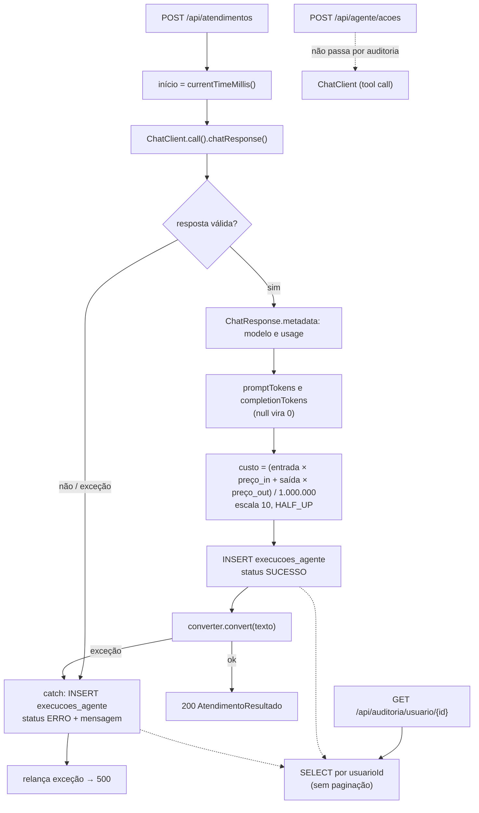

# 10 — Observabilidade, tracing e custos (AS-IS)

## 1. O que existe

| Mecanismo | Estado | Evidência |
|---|---|---|
| Auditoria de execuções de atendimento (modelo, tokens, custo, duração, status, erro) | IMPLEMENTADO | `AuditoriaService.java:28-98`, entidade `ExecucaoAgente` |
| Consulta da auditoria por usuário | IMPLEMENTADO | `AuditoriaController.java:24-29` |
| Cálculo de custo estimado a partir de preços configuráveis | IMPLEMENTADO | `AuditoriaService.java:62-76`, `application.yaml:62-65` |
| Actuator com `health`, `info`, `metrics` | CONFIGURADO | `application.yaml:56-60`, starter no `pom.xml:92-95` |
| Log SQL (`show-sql`) | CONFIGURADO | `application.yaml:19-22` |
| Log de aplicação (SLF4J) | NÃO ENCONTRADO. Nenhuma classe declara logger |
| Tracing (trace id ligando entrada, recuperação, modelo, tools e resposta) | NÃO ENCONTRADO. Sem Micrometer Tracing, OpenTelemetry nem id de correlação |
| Métricas próprias (contadores, timers por funcionalidade) | NÃO ENCONTRADO |
| Métricas de observação do Spring AI nos endpoints do actuator | NÃO VERIFICADO (a biblioteca pode registrar métricas de chat, mas não foi executado nem consultado `/actuator/metrics`) |
| Auditoria do fluxo de ação do agente | NÃO ENCONTRADO. `AcaoAgenteController` não chama `AuditoriaService` |
| Registro dos trechos recuperados por atendimento | NÃO ENCONTRADO |
| Registro das chamadas de tool (parâmetros e resultado) | PARCIAL. A solicitação criada fica em `solicitacoes_email`, mas sem vínculo com usuário, conversa ou execução |
| Custo de embeddings (ingestão e busca) | NÃO ENCONTRADO. Só o chat é contabilizado |
| Alertas, dashboards | NÃO ENCONTRADO |

## 2. Fluxo de tracing e custos como implementado

## 3. Detalhes e lacunas do cálculo de custo

- `usage.getPromptTokens()` e `getCompletionTokens()` nulos viram 0 (`:50-54`). Se `usage` for nulo, tokens e custo ficam `null` e o registro ainda sai como `SUCESSO`.
- Os preços (0.40 e 1.60 USD por milhão) são valores configurados. A correspondência com a tabela oficial do provedor para `gpt-4.1-mini` **não foi conferida**.
- O custo é por chamada de atendimento. Como o prompt inclui histórico de até 10 mensagens que carregam contexto de turnos anteriores (`06-fluxos-negocio.md`), o consumo de tokens de entrada tende a crescer com a conversa; isso é inferência do código, não medido.
- Quando há tool calling, o modelo é chamado mais de uma vez dentro de uma requisição. Se `usage` do `ChatResponse` cobre todas as chamadas ou só a última é **NÃO VERIFICADO**. De toda forma, esse fluxo não é auditado.
- A duração mede apenas a chamada ao modelo (`inicio` é tomado depois da busca vetorial), não a requisição inteira (`AtendimentoService.java:83`).
- Duplicidade: se `converter.convert` lançar exceção após `registrar`, o catch chama `registrarErro` e o mesmo atendimento tem dois registros (SUCESSO e ERRO).

## 4. Conteúdo registrado

- Nunca registrados em `execucoes_agente`: texto da pergunta, da resposta, do contexto e dos parâmetros de tool. Isso favorece a privacidade, mas impede reconstruir o que foi respondido (só a memória do Mongo guarda as mensagens).
- Registrados: identificadores de usuário e conversa, modelo, consumo, duração, status e mensagem de exceção bruta.

## 5. Identificação de requisição

Não há identificador que una uma requisição aos registros. `execucoes_agente.id` é um UUID próprio da auditoria e não é devolvido ao cliente. A única ligação é `usuarioId` + `conversaId`, que se repetem em vários turnos.
